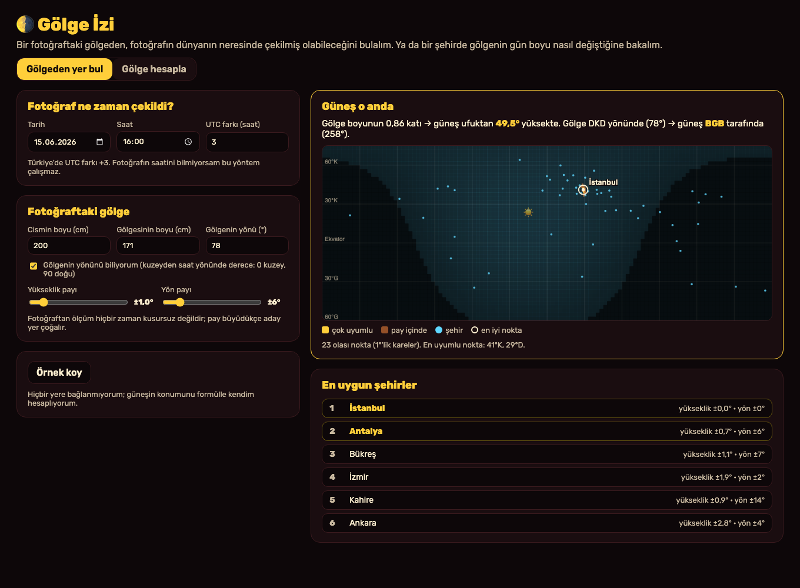
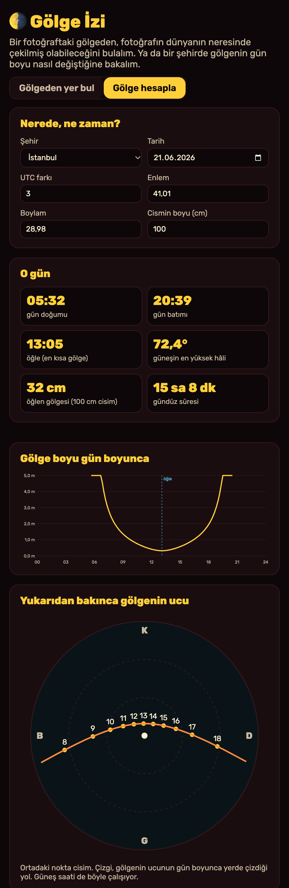

# Gölge İzi

Aklıma bu geldi: Bugün Reddit'te bir GeoGuessr uzmanının, evlat edinilmiş birinin annesinden kalan tek fotoğrafın çekildiği yeri bulduğunu okudum. Ben de fotoğraftan yer bulmanın yollarını merak ettim. Bunlardan biri **gölgeler**. Bir direğin boyu ile gölgesinin boyu, güneşin ufuktan kaç derece yüksekte olduğunu söyler. Fotoğrafın tarihini ve saatini de biliyorsam, dünyada güneşin tam o yükseklikte olduğu yerler bellidir. Gölgenin yönünü de biliyorsam aday yerler birkaç kareye iner. Ben bu aracı bunun için yaptım. Bu iki resim, benim çalıştırdığım uygulamanın gerçek ekranları.

## Ben nasıl kullanıyorum?

**Gölgeden yer bul**

1. Ben bu klasörde `python3 -m http.server 8000` çalıştırıyorum. Sonra `http://localhost:8000` açıyorum.
2. Ben fotoğrafın **tarihini, saatini ve UTC farkını** yazıyorum (Türkiye +3).
3. Ben fotoğraftaki bir cismin **boyunu** ve **gölgesinin boyunu** yazıyorum. Gerçek ölçü bilmesem de oran yeter (ör. direk 10 birim, gölge 8,5 birim).
4. Gölgenin hangi yöne düştüğünü biliyorsam **yönünü** derece olarak yazıyorum (0 kuzey, 90 doğu). Bilmiyorsam kutuyu kaldırıyorum.
5. Ben haritada **olası yerleri** (sarı), gece olan yerleri (koyu), güneşin tam tepede olduğu noktayı (☀️) ve **en uyumlu noktayı** görüyorum. Altta **en uygun şehirler** listesi var.
6. Ölçüm kusursuz olmadığı için **yükseklik payı** ve **yön payı** kaydırıcılarıyla aramayı genişletiyorum.

**Gölge hesapla**

1. Ben bir şehir seçiyorum ya da kendi enlem ve boylamımı yazıyorum. UTC farkı seçtiğim şehrin o tarihteki saatine göre (yaz saati dahil) kendiliğinden ayarlanıyor.
2. Ben o gün için gün doğumunu, gün batımını, öğleyi, güneşin en yüksek hâlini, öğlen gölgesini ve gündüz süresini görüyorum.
3. Ben **gölge boyunun gün boyunca** nasıl değiştiğini ve **gölgenin ucunun yerde çizdiği yolu** yukarıdan bakarak görüyorum. Güneş saati de böyle çalışıyor.

Ben "Örnek koy" ile hemen deneyebiliyorum. **Örnek ölçü uydurma**: İstanbul'da 15 Haziran 2026 saat 16:00'da 2 metrelik bir direğin gölgesini ben hesapladım. Araç bu ölçüden yeri geri bulabiliyor mu, onu görmek için.

## Ben içeride ne yaptım?

**Güneşin konumu.** Güneşin gökyüzündeki yerini ABD'nin okyanus ve atmosfer kurumu NOAA'nın güneş hesaplayıcısındaki formüllerle hesapladım. Bu formüller Jean Meeus'un *Astronomical Algorithms* kitabına dayanıyor:

- Tarihten **Jülyen gününü** buluyorum.
- Güneşin **eğimini** (deklinasyon: güneş ekvatorun ne kadar kuzeyinde ya da güneyinde) ve **zaman denklemini** (güneş saatinin kol saatinden kaç dakika ileri ya da geri olduğu) hesaplıyorum.
- Yerin enlemi, boylamı ve saatle güneşin **yüksekliğini** ve **azimutunu** (kuzeyden saat yönünde hangi yönde olduğunu) buluyorum.
- Ufka yakınken hava güneşi biraz yukarıda gösterdiği için **kırılma düzeltmesi** ekliyorum. Fotoğraftaki gölge bu görünen güneşe göre düşüyor.

**Gölge.** Gölgenin boyu `boy ÷ tan(yükseklik)`. Gölge, güneşin tam tersi yöne düşüyor.

**Yer bulma.** Dünyayı enlem 60°G ile 72°K arasında **1 derecelik karelere** ayırıp, her karede o anda güneşin yüksekliğini ve yönünü hesaplıyorum. Ölçüyle farkı paylar içinde kalan kareler aday. Yaklaşık 48.000 kare tarıyorum, birkaç milisaniye sürüyor.

**Gün olayları.** Gün doğumunu ve batımını, güneşin merkezinin ufkun 0,833° altında olduğu an olarak buluyorum (kırılma ve güneşin yarıçapı yüzünden). Bunu ikiye bölerek (binary search) dakika dakika daraltıyorum.

Ben `core.mjs` içinde hesapları, `app.mjs` içinde ekranı tuttum. Hiçbir sunucu, harita servisi, hesap ya da API anahtarı kullanmıyorum.

## Ben neyi sınadım?

Ben `node test.mjs` komutunu çalıştırdım. **58 kontrol** geçti.

- Güneşin eğimi gün dönümlerinde **±23,44°**, ekinoksta **0°** çıktı.
- Zaman denklemi 3 Kasım'da **+16,4 dakika**, 11 Şubat'ta **−14,2 dakika** çıktı. Bunlar yılın en uç değerleri.
- İstanbul'da 21 Haziran'da gün doğumu **05:32**, batımı **20:39**, öğlen yüksekliği **72,4°** (90 − 41,01 + 23,44) çıktı. 21 Aralık'ta öğlen yüksekliği **25,6°**.
- Öğlende güneş İstanbul'da tam güneyde, Sidney'de tam kuzeyde çıktı. Ekvatorda ekinoks öğlesinde güneş neredeyse tepede (89,96°) çıktı.
- 45° yükseklikte gölge tam boy kadar, 30°'de boyun √3 katı çıktı.
- Örnek ölçüden en uyumlu nokta **41°K, 29°D** çıktı, yani İstanbul. Şehir listesinde de İstanbul birinci oldu.
- **Rastgele 15 yer ve zamanda** güneşin konumunu hesaplayıp, o ölçüden geriye doğru yeri aradım. **15'inde de** 200 km içinde doğru yeri buldu.
- Gölgenin yönü bilinmeyince aday kare sayısı 23'ten **608'e** çıktı. Bunlar dünyada bir şerit oluşturuyor.

Denerken önemli bir hata yakaladım. İlk hâlinde gün doğumu ve batımını sadece o takvim gününün içinde arıyordum. Reykjavik'te 21 Haziran'da güneş gece yarısından sonra (00:04'te) battığı için araç **"güneş hiç batmıyor, 24 saat gündüz"** diyordu. Bu yanlıştı. Ayrıca şehir değiştirince UTC farkı +3'te kalıyordu. Şimdi doğuş ve batışı öğlenin 12 saat öncesinde ve sonrasında arıyorum. Her şehrin saat dilimini de tarayıcının saat dilimi verisinden alıyorum. Reykjavik'te doğuş 02:55, batış ertesi gün 00:04, gündüz **21 saat 9 dakika** çıktı. Londra'da kışın 08:03–15:53, yazın (UTC+1) 04:43–21:21 çıktı. Bunun için de testler ekledim.

Ben uygulamayı tarayıcıda da açtım. İki sekme, yön kutusu, paylar, gece saatinde dünyanın öbür tarafını bulması, sıfır boyda kırmızı uyarı ve şehir seçimi çalıştı. Telefon boyutunda (375 piksel) sayfa yana taşmadı.

Benim sınırlarım var. Haritada kıyı çizgileri yok; yerleri enlem-boylam çizgileri ve şehir noktalarıyla gösteriyorum. Fotoğrafın saati yanlışsa (telefon saati, saat dilimi) sonuç tamamen kayar. Gölgenin düştüğü yer eğimliyse ya da cisim dik değilse ölçü yanlış olur. Fotoğrafta perspektif yüzünden gölge boyunu ölçmek de zordur. Bu araç bir tahmin verir; tek başına bir yeri kanıtlamaz.

## Ben bunları nereden öğrendim?

- NOAA Global Monitoring Laboratory'nin güneş hesaplayıcısı ve hesap tablosundaki formüller.
- Jean Meeus, *Astronomical Algorithms*, Willmann-Bell, 1991 (2. baskı 1998).
- Gölgeden zaman ve yer bulma (İngilizcede "chronolocation"): açık kaynak araştırmacılarının bilinen bir yöntemi.

## Ben bugünün kaynaklarına nasıl baktım?

Ben 6 Kasım 2026 saat 10.11 Türkiye vaktinde [GitHub Trending günlük listesine](https://github.com/trending?since=daily) baktım. Gördüğüm 15 repo arasında ilk sırada [NVIDIA/auto-ontology](https://github.com/NVIDIA/auto-ontology) vardı ve "bugün 2.679 yıldız" yazıyordu. Bu, bütün GitHub'ın kesin birincisi olduğu anlamına gelmez. Ben onların kodunu kopyalamadım.

Ben aynı anda [Trends24 dünya listesinde](https://trends24.in/) `Happy Dhanteras` ifadesini ilk sırada gördüm. Projeme zorla eklemedim. Bu liste üçüncü taraf bir anlık görünümdür; bütün günün kesin en çok konuşulan konusu demem.

Ben [Reddit r/popular Top/Today listesinde](https://www.reddit.com/r/popular/top/?t=day) ilk sırada r/MadeMeSmile'daki ["Animals seeing their favorite person"](https://www.reddit.com/r/MadeMeSmile/comments/1xoif81/animals_seeing_their_favorite_person/) gönderisini gördüm. Aynı listede r/nextfuckinglevel'da [bir GeoGuessr uzmanının evlat edinilmiş birine annesinin fotoğrafının çekildiği yeri bulmasıyla ilgili gönderi](https://www.reddit.com/r/nextfuckinglevel/comments/1xonfu7/geoguessr_expert_helps_an_adoptee_find_the_exact/) vardı. Benim fikrim buradan çıktı. Ben o gönderideki yöntemi bilmiyorum; gölgeleri ben kendim seçtim. Bu tek görünüm, bütün Reddit'in en çok konuşulan konusunu kanıtlamaz.

Ben bu projeyi MIT lisansı ile paylaşıyorum.
